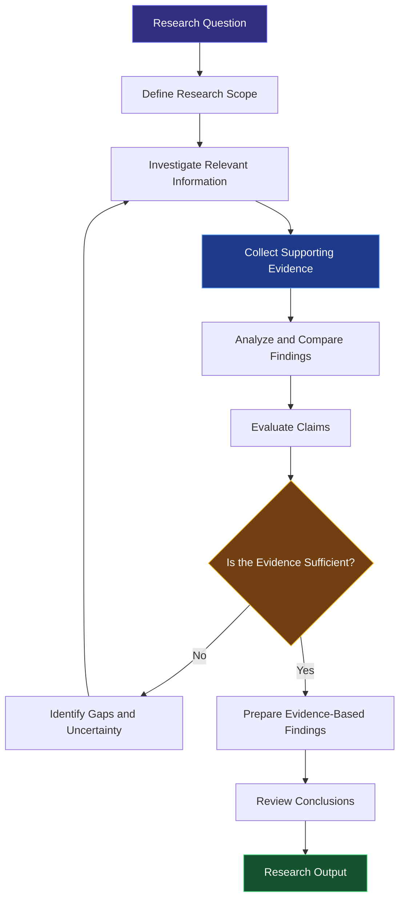
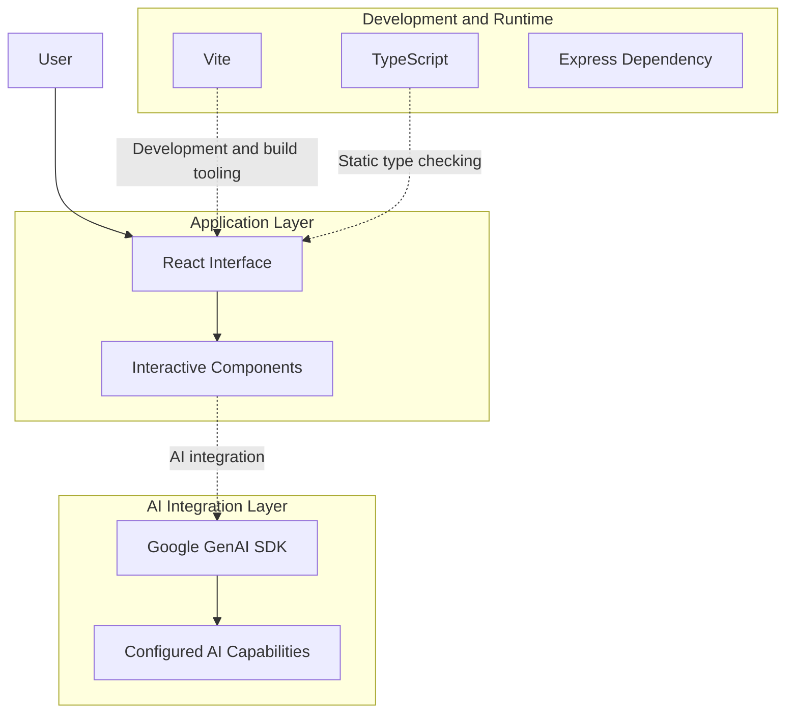

<div align="center">

# DRIVE

### Deep Research Intelligence & Verification Engine

**From research questions to evidence-backed insights.**

An AI-powered research project exploring how intelligent workflows, structured investigation, and evidence-based reasoning can make research more transparent, traceable, and reliable.

<br>

[](https://github.com/zvi-py/DRIVE)
[](https://github.com/zvi-py/DRIVE)
[](https://www.typescriptlang.org/)
[](https://react.dev/)

<br>

**Investigate thoughtfully. Evaluate evidence. Make conclusions traceable.**

</div>

---

## Table of Contents

* [Overview](#overview)
* [The Problem](#the-problem)
* [Our Vision](#our-vision)
* [Core Principles](#core-principles)
* [Research Workflow](#research-workflow)
* [System Architecture](#system-architecture)
* [Technology Stack](#technology-stack)
* [Getting Started](#getting-started)
* [Environment Configuration](#environment-configuration)
* [Available Commands](#available-commands)
* [Project Structure](#project-structure)
* [Research Quality and Verification](#research-quality-and-verification)
* [Responsible AI](#responsible-ai)
* [Development Roadmap](#development-roadmap)
* [Contributing](#contributing)
* [Author](#author)

---

## Overview

Research is no longer limited by access to information. The real challenge is determining which information deserves to be trusted.

Modern AI systems can retrieve information, summarize documents, compare perspectives, and generate detailed reports in seconds. However, a convincing answer is not necessarily a correct one. Sources can disagree, evidence can be incomplete, and generated conclusions can extend beyond what the available information actually supports.

**DRIVE — Deep Research Intelligence & Verification Engine** — explores a more structured approach to AI-assisted research.

The project's central idea is to move beyond simply generating answers and toward making the research process more transparent, systematic, and evidence-oriented.

Instead of treating a polished response as the final measure of success, DRIVE emphasizes a more important question:

> Can a conclusion be traced back to evidence, critically evaluated, and independently examined?

### What DRIVE aims to achieve

* **Structured investigation:** Organize complex research questions into a more systematic workflow.
* **Evidence-oriented reasoning:** Encourage conclusions grounded in relevant supporting information.
* **Critical analysis:** Identify conflicting information, incomplete evidence, and unresolved questions.
* **Verification-first thinking:** Distinguish plausible statements from conclusions that have actually been checked.
* **Research transparency:** Make the relationship between evidence and conclusions easier to understand.
* **Responsible AI assistance:** Acknowledge uncertainty and preserve the importance of human judgment.

DRIVE represents an exploration of how AI can support not just faster research, but better research practices.

---

## The Problem

AI has made information synthesis faster, but speed alone does not guarantee research quality.

A typical AI-generated research response can introduce several challenges:

| Challenge             | Why It Matters                                                                     |
| --------------------- | ---------------------------------------------------------------------------------- |
| Unsupported claims    | Statements may sound authoritative without sufficient evidence.                    |
| Source reliability    | Retrieved information may be outdated, incomplete, biased, or irrelevant.          |
| Conflicting evidence  | Different sources may support contradictory interpretations.                       |
| Unclear reasoning     | Readers may struggle to understand how a conclusion was reached.                   |
| Unverified statistics | Numbers and findings may be repeated without independent validation.               |
| Hidden uncertainty    | Missing information can be obscured by confident language.                         |
| Limited traceability  | It can be difficult to connect individual conclusions to their supporting sources. |

These challenges become especially important in scientific investigations, technical research, competitive analysis, and other situations where decisions depend on accurate information.

### The central question

**What if AI-assisted research were designed around examining and verifying information rather than simply generating it?**

DRIVE explores this direction by treating research as a process that should be organized, investigated, evaluated, and checked.

---

## Our Vision

The vision behind DRIVE is to make AI-assisted research more systematic and easier to evaluate.

A useful research system should help users understand not only what a conclusion says, but also why that conclusion was reached and how strongly the available evidence supports it.

The project's conceptual approach brings together four stages.

### 01. Research

Start with a research question and establish what needs to be investigated.

A well-defined scope helps clarify the objective, identify relevant topics, and reduce the likelihood of overlooking important aspects of the question.

### 02. Evidence

Collect and organize information relevant to the investigation.

Sources should be evaluated in context rather than accepted simply because they appear in a search result or an AI-generated response.

### 03. Analysis

Examine the collected information, compare different perspectives, and evaluate how strongly the evidence supports the conclusions under consideration.

Conflicting findings and information gaps should be treated as part of the investigation rather than ignored.

### 04. Verification

Distinguish checked conclusions from assumptions, interpretations, and unresolved questions.

Verification should clarify the limits of available evidence rather than create an artificial impression of certainty.

These stages describe the project's guiding methodology. The exact capabilities and degree of automation depend on the current implementation.

---

## Core Principles

### Evidence over confidence

A confidently written answer is not necessarily a reliable answer.

DRIVE emphasizes the importance of examining supporting information before accepting a conclusion.

### Traceability over black-box answers

Research becomes more useful when readers can understand where a conclusion came from and what information supports it.

Traceability is an important design objective for making AI-assisted research easier to inspect.

### Verification over assumption

Plausibility and correctness are different things.

Claims that require verification should not be treated as confirmed merely because they fit an expected narrative.

### Transparency over false certainty

A useful research system should recognize when the available information is insufficient.

Uncertainty, conflicting findings, and evidence gaps deserve explicit consideration.

### Human judgment over blind automation

AI can accelerate investigation and information synthesis, but consequential conclusions may still require domain expertise, independent evaluation, and human oversight.

---

## Research Workflow

The following diagram illustrates the conceptual workflow that guides DRIVE.



### How the workflow works

**Research question to scope**

Define the question, establish its boundaries, and determine which aspects require investigation.

**Scope to information gathering**

Identify relevant material and collect information appropriate to the research objective.

**Evidence to analysis**

Examine the relationship between claims and supporting information. Compare sources where appropriate and identify disagreements.

**Analysis to verification**

Evaluate whether the available evidence supports the proposed conclusions.

**Verification to research output**

Organize findings into an understandable result while preserving important limitations and unresolved questions.

If the evidence is insufficient, the conceptual workflow returns to investigation instead of forcing a definitive conclusion.

*This diagram describes the intended research methodology and should not be interpreted as a guarantee that every stage is currently automated.*

---

## System Architecture

DRIVE uses a modern web technology stack, with an emphasis on building an interface through which AI-assisted capabilities can be developed and presented.

At a conceptual level, the system can be understood through three layers.



The diagram represents the project's technology layers and intended relationship between the application and AI-assisted functionality. It is a conceptual overview, not a complete deployment diagram.

### Application layer

React provides the foundation for building the user interface through reusable components.

TypeScript adds static typing and helps identify certain classes of errors during development.

### AI integration layer

The project includes Google's GenAI SDK, providing a foundation for integrating Google's generative AI capabilities.

The precise models, prompts, tools, and research operations available depend on the application's implementation and environment configuration.

### Development and runtime layer

Vite supports the frontend development and production build workflow.

Express is also included as a dependency, providing the option to develop server-side functionality. Its presence alone does not establish which backend routes or services are currently implemented.

---

## Technology Stack

DRIVE uses a modern collection of web technologies and libraries.

| Technology                                                | Purpose                                                              |
| --------------------------------------------------------- | -------------------------------------------------------------------- |
| [React](https://react.dev/)                               | Component-based user interface                                       |
| [TypeScript](https://www.typescriptlang.org/)             | Static typing and maintainable application code                      |
| [Vite](https://vite.dev/)                                 | Development server and production build tooling                      |
| [Google GenAI SDK](https://ai.google.dev/gemini-api/docs) | Integration with Google's generative AI services                     |
| [Tailwind CSS](https://tailwindcss.com/)                  | Utility-first styling                                                |
| [Three.js](https://threejs.org/)                          | 3D graphics capabilities                                             |
| [Motion](https://motion.dev/)                             | Animation and interaction capabilities                               |
| [Lenis](https://lenis.darkroom.engineering/)              | Smooth scrolling capabilities                                        |
| [Lucide React](https://lucide.dev/)                       | Icon components                                                      |
| [Express](https://expressjs.com/)                         | Server-side application framework                                    |
| [Node.js](https://nodejs.org/)                            | JavaScript runtime for development tooling and server-side execution |

**Languages and tooling:** TypeScript, JavaScript, HTML, CSS, and the npm-compatible package ecosystem.

The technologies listed above represent the project's dependencies and tooling. Not every library necessarily powers a user-facing feature in the current version.

---

## Getting Started

Follow these instructions to set up the project locally.

### Prerequisites

Make sure you have the following installed:

* [Git](https://git-scm.com/) for version control.
* [Node.js](https://nodejs.org/) with a version compatible with the installed dependencies.
* npm, Bun, or another compatible package manager.
* A Google AI API key if required by the application's current AI integration.

### 1. Clone the repository

```bash
git clone https://github.com/zvi-py/DRIVE.git
```

Navigate to the project directory:

```bash
cd DRIVE
```

### 2. Install dependencies

Using npm:

```bash
npm install
```

Alternatively, if you use Bun:

```bash
bun install
```

Use one package manager consistently and retain the corresponding lockfile.

### 3. Configure environment variables

Check the `.env.example` file in the repository.

Create a local environment file using the format supported by the application and copy the relevant variable names from the example.

For instance, a Google AI integration may require a key similar to:

```env
GEMINI_API_KEY=your_api_key_here
```

The variable above is illustrative. Confirm the exact name expected by the application's source code before using it.

Never commit API keys, credentials, or private environment files to GitHub.

### 4. Start the development server

Run:

```bash
npm run dev
```

The Vite configuration specifies port `3000` for the development server.

Open the local address shown in your terminal, typically:

```text
http://localhost:3000
```

### 5. Build for production

Generate the production build:

```bash
npm run build
```

Vite normally generates production assets in the `dist/` directory.

To preview the production build locally:

```bash
npm run preview
```

---

## Environment Configuration

AI-powered applications often depend on external services and credentials.

Before running DRIVE, verify the following configuration requirements.

| Configuration           | Purpose                                                          |
| ----------------------- | ---------------------------------------------------------------- |
| Google AI credentials   | Authenticate requests to the configured AI service, if required  |
| Model configuration     | Specify the model used by the AI integration, if configurable    |
| Application environment | Supply additional variables required by the implemented features |

### Security recommendations

* Keep API keys in local environment files.
* Ensure private environment files are excluded from version control.
* Never expose privileged API keys in browser-delivered code.
* Keep sensitive AI-service credentials on the server when server-side requests are required.
* Validate external inputs before processing them.
* Avoid logging secrets or sensitive user data.
* Review the applicable provider's API limits and data policies.

All environment variable names must match the actual application configuration.

---

## Available Commands

The following commands are defined in the current project configuration.

| Command           | Description                                        |
| ----------------- | -------------------------------------------------- |
| `npm run dev`     | Start the Vite development server                  |
| `npm run build`   | Build the application for production               |
| `npm run preview` | Preview the production build                       |
| `npm run lint`    | Run the configured TypeScript no-emit check        |
| `npm run clean`   | Remove the configured build output and `server.js` |

### Recommended development workflow

1. Create a dedicated branch for your changes.
2. Install dependencies.
3. Configure the required environment variables.
4. Run the development server.
5. Test the affected functionality.
6. Run the TypeScript check.
7. Build the application to identify production-build errors.
8. Review the changes before opening a pull request.

Run the checks with:

```bash
npm run lint
npm run build
```

The current `lint` script runs TypeScript checking rather than a conventional ESLint rule set.

---

## Project Structure

The repository contains the following top-level files and directories.

```text
DRIVE/
├── src/                 # Application source code
├── public/              # Static assets and research documentation PDF
│   └── assets/aistudio/DRIVE_Research_Paper_Final_310ecd38.pdf
├── docs/                # Research papers and technical publications
│   └── DRIVE_Research_Paper_Final.pdf
├── .env.example         # Example environment configuration
├── .gitignore           # Git exclusion rules
├── index.html           # Application HTML entry point
├── metadata.json        # Project metadata
├── package.json         # Dependencies and npm scripts
├── bun.lock             # Bun dependency lockfile
├── tsconfig.json        # TypeScript configuration
└── vite.config.ts       # Vite configuration
```

### Key files

**`src/`**

Contains the application source code and associated implementation.

**`docs/` & `public/`**

Contains the official research paper documentation (`DRIVE_Research_Paper_Final.pdf`), technical figures, and assets.

**`.env.example`**

Provides an example of the environment configuration expected by the project.

**`package.json`**

Defines the project's dependencies, metadata, and development commands.

**`tsconfig.json`**

Configures TypeScript behavior.

**`vite.config.ts`**

Defines the Vite development and build configuration.

**`index.html`**

Provides the HTML entry point for the web application.

This structure can evolve as the application develops additional research and verification capabilities.

---

## Research Quality and Verification

Verification is central to DRIVE's vision.

An AI-assisted research workflow can be evaluated across several dimensions.

| Dimension              | Evaluation Question                                                   |
| ---------------------- | --------------------------------------------------------------------- |
| Evidence coverage      | Are important claims supported by relevant sources?                   |
| Source quality         | Are the sources appropriate and reliable for the research question?   |
| Claim accuracy         | Do the cited materials actually support the associated claims?        |
| Contradiction handling | Are meaningful disagreements between sources acknowledged?            |
| Reproducibility        | Can another person inspect the evidence and follow the investigation? |
| Uncertainty            | Are limitations and evidence gaps communicated clearly?               |

These dimensions provide a framework for evaluating the quality of research outputs.

They should not be interpreted as claims that DRIVE already implements a complete automated evaluation suite or guarantees factual accuracy.

### From generated answers to verifiable findings

There is an important distinction between different levels of confidence in a research result:

* **Generated:** Produced by an AI system.
* **Supported:** Accompanied by relevant evidence.
* **Checked:** Examined against the available evidence.
* **Independently validated:** Confirmed through an appropriate independent process.

These categories are not interchangeable.

A citation does not automatically establish that a claim is true. Similarly, an automated verification step cannot eliminate every possibility of error.

The broader goal is to make the path from information to conclusion more transparent and easier to evaluate.

---

## Responsible AI

DRIVE is an evolving project exploring evidence-oriented AI research.

Like other AI-assisted systems, its outputs may be affected by incomplete information, unreliable sources, ambiguous questions, model limitations, or incorrect interpretations of evidence.

Users should:

* Independently examine important claims.
* Check primary sources whenever possible.
* Treat conflicting evidence as a reason for further investigation.
* Avoid interpreting generated content as automatically verified.
* Exercise additional care in scientific, medical, legal, financial, and other high-stakes contexts.
* Avoid using generated research as a substitute for qualified professional judgment.

**The objective is to support better research practices, not to promise perfect or error-free answers.**

---

## Development Roadmap

The following roadmap outlines potential directions for future development. These are prospective improvements rather than claims that the features have already been implemented.

### Phase 1: Research Foundation

* [ ] Refine the research question and investigation workflow.
* [ ] Establish a clear separation between generated claims and supporting evidence.
* [ ] Improve the organization of research findings.
* [ ] Document the current architecture and configuration.
* [ ] Establish baseline evaluation criteria.

### Phase 2: Evidence Intelligence

* [ ] Explore structured source collection and organization.
* [ ] Develop claim-to-evidence mapping.
* [ ] Investigate source reliability and relevance assessment.
* [ ] Improve the identification of conflicting findings.
* [ ] Make evidence gaps easier to identify.

### Phase 3: Verification and Evaluation

* [ ] Explore automated checks for unsupported claims.
* [ ] Develop repeatable research-quality evaluations.
* [ ] Investigate evidence coverage and traceability metrics.
* [ ] Improve uncertainty reporting.
* [ ] Add tests for important research workflows.

### Phase 4: Research Transparency

* [ ] Explore structured research histories.
* [ ] Improve the reproducibility of investigations.
* [ ] Investigate exportable research reports.
* [ ] Develop clearer explanations of how conclusions relate to evidence.
* [ ] Explore human review and feedback workflows.

### Long-term vision

Build toward an AI research environment where users can investigate complex questions, examine supporting evidence, understand uncertainty, and evaluate conclusions with greater confidence.

The objective is not simply to make research faster.

**It is to make the results of AI-assisted research easier to understand, inspect, and trust.**

---

## Contributing

Contributions, suggestions, and constructive feedback are welcome.

If you are interested in AI research systems, evidence evaluation, software engineering, or trustworthy AI, there are several ways to contribute.

### Ways to contribute

* Report bugs or unexpected behavior.
* Suggest improvements to the research workflow.
* Propose approaches to evidence evaluation.
* Improve documentation.
* Contribute tests.
* Identify usability issues.
* Suggest improvements to the application's architecture.

### Contribution workflow

1. Fork the repository.
2. Create a feature branch.
3. Implement your changes.
4. Run the available checks.
5. Submit a pull request describing the change and its motivation.

For substantial changes, consider opening an issue first to discuss the proposed approach.

Please ensure that contributions are clearly documented and do not introduce exposed credentials or unsupported claims about system capabilities.

---

## Author

<div align="center">

### Zaveriya Mulla

**AI & Data Science Engineering Student**

AI Systems | Research Intelligence | Software Development

I am interested in building practical AI systems that go beyond generating outputs to address deeper challenges involving reasoning, reliability, and real-world usability.

DRIVE represents an exploration of how AI-assisted research can become more structured and evidence-oriented, with verification and transparency treated as important parts of the process.

<br>

[GitHub](https://github.com/zvi-py)   |   [LinkedIn](https://linkedin.com/in/zaveriya)

</div>

---

<div align="center">

**DRIVE — Deep Research Intelligence & Verification Engine**

*Better research begins with better questions.*

If you find this project interesting, consider starring the repository and following its development.

</div>
